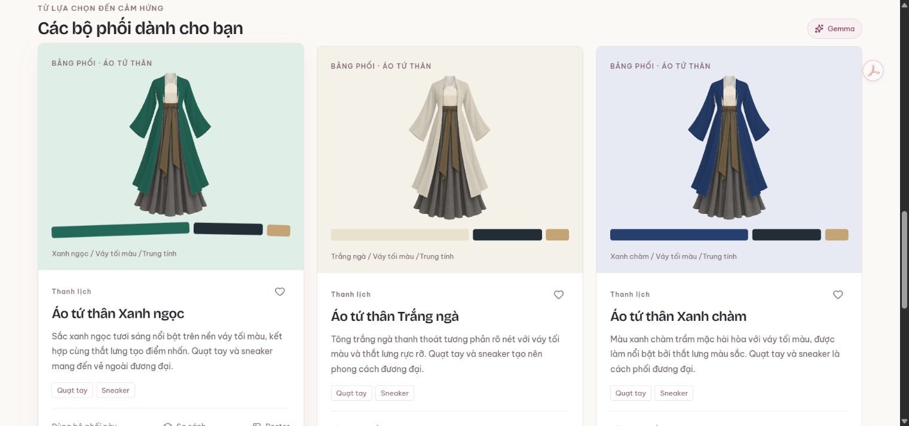
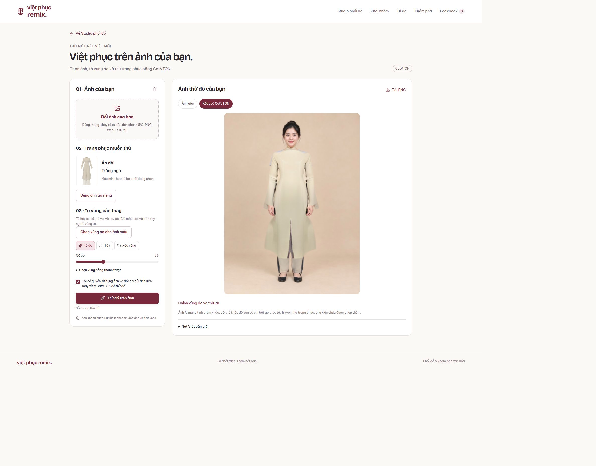

# Minh chứng Audition 2026

- [Video giới thiệu](https://Vipersolowkey.github.io/viet-phuc-remix/)
- [Demo công khai](https://viet-phuc-remix.viperzzz2k6.chatgpt.site/)
- [Gemini thật](https://share.gemini.google/AfVs8fdZqsJ9)
- [Bài trình bày](AUDITION.md) và [kiểm chứng](QA-AUDITION.md)




# Việt phục Remix

Ứng dụng phối Việt phục cho học sinh, sinh viên: chọn trang phục, sự kiện, màu và phụ kiện; nhận ba thẻ phối, tìm hiểu văn hóa, so sánh hai phương án và lưu lookbook cá nhân. Try-on dùng CatVTON trong thành phần GPU đi kèm mã nguồn; xem `tryon/README.md`.

## Chạy dự án

Node.js >= 22.13.0. Cài từ package-lock.json bằng `npm run install:ci`, sau đó chạy `npm run dev`. Bản phát triển mở trên http://127.0.0.1:5173.

## Tính năng

- Áo dài, áo tứ thân, áo ngũ thân.
- 5 sự kiện, 3 phong cách, 6 màu, 6 phụ kiện (chọn tối đa 3).
- Ba phương án dùng cùng trang phục, sự kiện và phụ kiện, với ba bảng màu khác nhau.
- Thẻ văn hóa có nguồn; lưu ý theo bối cảnh, phụ kiện cách tân.
- So sánh hai phương án; lưu và xóa lookbook.
- Lookbook được lưu trong Cloudflare D1, tách theo danh tính ChatGPT do nền tảng xác thực. Không lưu bằng localStorage.
- Giao diện tiếng Việt, hỗ trợ bàn phím và màn hình nhỏ.

## Color Lab và poster

Color Lab thử phối trung tính, tương đồng (+30° hue) và bổ túc (+180° hue). Lớp nền ngà/tối được giữ theo trang phục; điểm nhấn được giảm độ bão hòa và dùng ở tỷ lệ tham khảo 10%. Áp dụng sẽ cập nhật các thẻ phối. Cách phối màu được lưu cùng bộ phối; các bản lưu cũ tự dùng trung tính, không cần migration. Đây là công cụ thẩm mỹ, không phải đánh giá đúng-sai văn hóa.

Nút Poster trên mỗi thẻ mở trình xem trước Canvas, đặt tên tối đa 80 ký tự và chọn PNG 1080×1350 hoặc 1080×1920. Ảnh có bảng màu, sự kiện, phong cách, phụ kiện, đặc trưng trang phục và nguồn. Xử lý hoàn toàn trong trình duyệt, không cần Gemini hay đăng nhập, không tự đăng lên mạng xã hội.

## AI: Ollama Cloud và Gemini

API `/api/suggestions` chạy phía máy chủ. Bản hiện tại chọn `AI_PROVIDER=ollama`, gọi `https://ollama.com/api/chat` với `OLLAMA_API_KEY` là secret và `OLLAMA_MODEL` mặc định `gemma4:31b`. Không cần chạy Ollama trên laptop. Khóa chỉ nằm ở server, không gửi vào trình duyệt hoặc Git. Xem `.env.example` để biết tên biến; cấu hình bản online qua Sites environment variables, rồi deploy để áp dụng.

Gemini vẫn là lựa chọn khác khi đặt `AI_PROVIDER=gemini` và cấu hình secret `GEMINI_API_KEY`; `GEMINI_MODEL` mặc định `gemini-2.5-flash`. Khi không đặt provider, server chọn Ollama nếu có khóa Ollama, nếu không chọn Gemini. Không tự chuyển giữa hai dịch vụ khi một dịch vụ lỗi.

AI diễn giải tên và lý do của 3 phương án đã được cấu trúc. Hai dịch vụ dùng chung prompt tại `lib/gemini.ts`; Ollama có adapter tại `lib/ollama.ts`. Prompt cung cấp lựa chọn và bộ tư liệu; mô hình không tự chọn mã trang phục hoặc phụ kiện. Dữ liệu văn hóa hiển thị trực tiếp từ `lib/remix.ts`, không lấy từ văn bản do mô hình tạo.

Đầu ra phải là JSON đúng schema, đủ 3 phương án, không bị cắt. Ollama Cloud chưa hỗ trợ ép JSON schema: prompt yêu cầu JSON, server kiểm tra Zod và trạng thái hoàn tất; từ chối trường bổ sung hoặc kết quả không hợp lệ. Timeout Ollama 14 giây, Gemini 12 giây; lỗi/quota/đầu ra không hợp lệ chuyển về gợi ý có sẵn và ghi rõ provider. Yêu cầu đăng nhập để gọi AI; giới hạn 20 yêu cầu/người/giờ là best effort theo Worker isolate, chưa phải quota phân tán toàn hệ thống.

Không coi kết quả Ollama là kết quả Gemini. Kiểm thử Gemini dùng phản hồi mô phỏng; chưa xác minh một lần gọi Google thật. Cuộc trò chuyện rà soát và thử prompt Gemini thật: https://share.gemini.google/AfVs8fdZqsJ9.

Ngày 10/10/2026 đã kiểm chứng adapter bằng Ollama Cloud thật (`gemma4:31b`): ba phương án áo ngũ thân trả về trong khoảng 2,8 giây, đúng schema; mã trang phục, bảng màu và phụ kiện giữ nguyên. Đây là minh chứng Ollama, không phải một lượt gọi Gemini.

Tham khảo API: https://ai.google.dev/api/generate-content và https://ai.google.dev/gemini-api/docs/generate-content/structured-output.

Ollama Cloud: https://docs.ollama.com/cloud và https://docs.ollama.com/capabilities/structured-outputs.

Giao diện gọi model là **Gemma**, còn nhà cung cấp API là Ollama Cloud (`gemma4:31b`). Kết quả thành công không kèm lời giải thích kỹ thuật. Tên gợi ý tối đa 60 ký tự, lý do tối đa 320 ký tự, là văn bản thuần; server từ chối HTML, Markdown, URL, ký tự điều khiển và nội dung quá dài. Dữ liệu lookbook cũ vẫn được đọc theo giới hạn cũ (80/600). Lưu ý văn hóa chi tiết mở bằng mục “Lưu ý khi mặc” hoặc “Lưu ý tại sự kiện”.

QA nội dung ngày 10/10/2026: 15 cấu hình cuối tạo 45 thẻ bằng API thật, đủ ba trang phục, năm dịp, sáu màu, ba phong cách/cách phối màu và 0–3 phụ kiện. Tất cả đúng schema; tên dài nhất 31 ký tự, lý do dài nhất 133 ký tự; lượt chậm nhất khoảng 2,8 giây. Đã sửa cách viết ngữ cảnh thắt lưng tứ thân để phân biệt màu điểm nhấn với váy tối màu. Đây là kiểm tra mẫu, không bảo đảm mọi lần sinh đều đúng; lỗi đầu ra vẫn chuyển về gợi ý có sẵn.

## Cơ sở dữ liệu và xác thực

Binding logic `DB` trong `.openai/hosting.json`. Schema `db/schema.ts`; migration ở `drizzle/`. Sites áp dụng migration khi xuất bản. Với preview cục bộ, build để sinh `dist/server/wrangler.json`, rồi áp dụng migration:

```
node --import ./scripts/sites-env.mjs ./node_modules/wrangler/bin/wrangler.js d1 execute DB --local --config dist/server/wrangler.json --persist-to .wrangler/state --file drizzle/0000_sudden_master_chief.sql
```

Đăng nhập thử nghiệm cục bộ qua `/signin-with-chatgpt?return_to=/`. Định danh thử nghiệm chỉ có ở localhost; khi xuất bản, nền tảng cung cấp định danh người dùng. Mọi thao tác lookbook đều yêu cầu danh tính phía máy chủ và truy vấn theo owner. Tối đa 100 bộ phối/người. Không có chia sẻ lookbook công khai trong bản này.

## Nguồn văn hóa

- Vietnam Tourism, “All about ao dai”: https://vietnam.travel/node/1216
- Bảo tàng Phụ nữ Việt Nam, “Thời trang và nghệ thuật tạo hoa văn”: https://baotangphunu.org.vn/thoi-trang-va-nghe-thuat-tao-hoa-van/
- Bảo tàng Phụ nữ Nam Bộ, “Áo dài xưa và nay” (cấu trúc tứ thân): https://baotangphunu.com/ao-dai-xua-va-nay/
- Bảo tàng Phụ nữ Nam Bộ, “Áo dài ngũ thân – hành trình trở lại”: https://baotangphunu.com/4266-2/

Thông tin là bản tóm lược phổ thông; không coi mọi biến thể là phục dựng lịch sử. Khuyến nghị phối màu và phụ kiện là đề xuất thẩm mỹ, không phải quy định văn hóa. Cần người nghiên cứu/nghệ nhân thẩm định trước khi mở rộng dữ liệu hoặc đưa ra đánh giá đúng-sai.

## Hình ảnh

`public/ao-dai-editorial.png` là minh họa AI được tạo cho demo: áo dài đỏ rượu, quần ngà, giày đen. Đây là ảnh cảm hứng lưu trong nguồn, không phải virtual try-on hoặc hiện vật lịch sử. Studio hiện dùng ba mockup trung tính thay đổi theo lựa chọn.

## Kiểm tra

```
node node_modules/typescript/bin/tsc --noEmit
node --test tests/remix.test.mjs
node tests/api-check.mjs
npm run build
```

Kiểm tra API cần dev server và migration cục bộ. Script tạo và xóa riêng dữ liệu `qa:`. Test Gemini dùng fetch mô phỏng, không gọi API trả phí.

Hồ sơ Audition ngày 10/10/2026 có minh chứng Gemini thật tại https://share.gemini.google/AfVs8fdZqsJ9; vai trò và kiến trúc xem AUDITION.md. Runtime online dùng Gemma; CatVTON đã kiểm tra GPU cục bộ.

## Phông chữ

Giao diện và poster dùng Be Vietnam Pro (nội dung) cùng Bricolage Grotesque (tiêu đề). Tệp WOFF2 lưu trong `public/fonts`, gồm các tập ký tự tiếng Việt, Latin và Latin mở rộng; không cần tải phông từ dịch vụ bên ngoài khi sử dụng. Giấy phép SIL Open Font License đi kèm từng bộ phông. Poster chờ phông tải xong trước khi vẽ và xuất PNG.

## Mockup động và bộ sưu tập

Studio và mỗi thẻ có mockup Canvas cho ba trang phục, đổi màu trực tiếp từ lựa chọn. Ba minh họa AI trung tính nằm trong `public/mockups`; hiệu ứng tô vải chạy trong trình duyệt, giữ ảnh gốc. Phụ kiện là ký hiệu kèm tên, không được ghép lên cơ thể. Kiểu dáng được giản lược; không xác nhận độ chính xác may đo hay phục dựng lịch sử. Màu hiển thị là mô phỏng với bóng vải; tham khảo mã HEX trong bảng màu.

Lookbook có bộ sưu tập được lưu D1, tối đa 20/người, tên tối đa 60 ký tự. Một look có thể ở nhiều bộ sưu tập. Xóa bộ sưu tập giữ các look; xóa look dọn liên kết trong bộ sưu tập. API `/api/collections` kiểm tra danh tính, nguồn yêu cầu và sở hữu phía máy chủ. Migration bổ sung `drizzle/0001_graceful_tiger_shark.sql`.

Collage chọn 1–6 look đã lưu, xuất PNG rộng 1080px, cao theo số hàng; có mockup, bảng màu, phụ kiện và nguồn văn hóa từng look. Tệp xử lý cục bộ, không tự chia sẻ. Kiểm tra mới: `node tests/collections-api.mjs` (cần server và các migration cục bộ).

## Tủ đồ, nhóm và chuẩn bị sự kiện

- Tủ đồ: 60 áo/người với loại, nhóm màu và ghi chú 120 ký tự; sửa/xóa có xác nhận, đánh dấu đồ mặc cùng và sáu loại phụ kiện. Gợi ý dùng đúng áo đã nhập và phụ kiện đang có, kèm các món chưa có theo mockup. Không có giá bán hoặc độ chính xác màu vải được bảo đảm.
- Nhóm: tối đa 10 kế hoạch, mỗi kế hoạch 2–6 thành viên. Dịp chung, bảng màu cùng tông/xen ngà/nhóm tông, chỉnh riêng trang phục, màu, phong cách và phụ kiện. Xem tổng thể, lưu/mở lại, chuyển vào Studio rồi cập nhật ngược đúng thành viên, lưu từng bộ vào lookbook và xuất PNG nhóm. Bản nháp còn khi đổi tab; nhắc trước khi chuyển kế hoạch hoặc đóng trang khi có thay đổi. Kế hoạch do một tài khoản quản lý, chưa có cộng tác nhiều người.
- Checklist: theo bộ đang chọn và bối cảnh trong/ngoài nhà, đi bộ, thời tiết tự chọn. Lưu tiến độ cho tối đa 30 bộ/bối cảnh gần đây; khi thêm bối cảnh thứ 31, bỏ tiến độ cũ nhất. Thời tiết không phải API dự báo. Checklist là gợi ý chuẩn bị, không thay quy định của địa điểm.
- Quiz: sáu câu được biên soạn cố định từ Vietnam Tourism và Bảo tàng Phụ nữ Nam Bộ, có giải thích/nguồn từng câu, xem lại đáp án, chơi lại và lưu kỷ lục. Không gọi AI để sinh kiến thức văn hóa tùy ý.

API `/api/workspace` lưu JSON có schema kiểm tra vào D1, yêu cầu danh tính phía máy chủ, kiểm tra Origin khi ghi. Mỗi bản ghi thuộc một owner; cập nhật có revision để từ chối ghi đè dữ liệu từ phiên cũ (409). Giao diện giữ dữ liệu nhập khi báo xung đột, tải bản mới và yêu cầu thực hiện lại thay đổi. Lỗi ghi mạng không được báo là đã lưu; phải tải lại để xác nhận trạng thái. Migration mới: `drizzle/0002_absurd_doctor_doom.sql`.

Điều hướng có URL `?view=…`, hỗ trợ back/forward. Lựa chọn Studio được giữ trong sessionStorage của tab khi tải lại; dữ liệu cá nhân lưu theo tài khoản trên máy chủ. Lookbook, áo và kế hoạch có hộp xác nhận trước khi xóa. Color Lab mở từ Studio để điều hướng chính tập trung vào năm công việc.

Kiểm tra bổ sung: `node tests/workspace-api.mjs` (chỉ localhost, có phục hồi fixture sau test), `node tests/collections-api.mjs`, và mười bài kiểm tra logic trong `tests/remix.test.mjs`. Các test Gemini tiếp tục dùng mock; chưa có bằng chứng gọi Gemini thật. Việc xuất bản thành công không thay thế thử nghiệm dịch vụ Gemini, kiểm thử tải hoặc đánh giá nội dung bởi chuyên gia.
